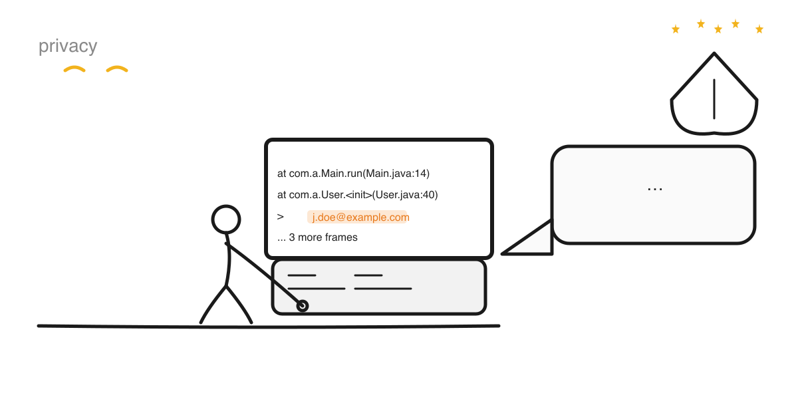
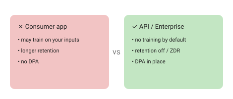

Using an AI assistant while you build is normal now. The moment I keep getting wrong is right before I hit Enter: mid-bug, the stack trace is already on my clipboard. Am I thinking about whose email is buried in line 40? I'm not sure I ever am.

One keypress and that trace is on somebody else's servers. If it identifies a person, I have just processed personal data, and GDPR has opinions about that.

This is a practical orientation for developers and agencies, not legal advice. I'm in Switzerland, where the revFADP is broadly analogous to GDPR but a *separate* regime — check your own.

## It's the content, not the tool

GDPR applies whenever personal data (any information about an identifiable person) is processed. Pasting content into a prompt is processing.

Code itself is usually fine to send — but dev artefacts quietly carry personal data all the time:

- commit authors and emails in git history;
- names, emails and IPs in logs and stack traces;
- support tickets, screenshots, meeting notes;
- database dumps, fixtures, CMS exports with customer content.

A `git log` on most projects is a staff directory with the whitespace taken out.

So the useful question is what's *in* what I'm sending. It's also the question I'm worst at answering in the moment, which is exactly how the stack trace above gets sent.

## Who's who: controller, processor, DPA

Fair warning: this section is dense with three-letter acronyms. I don't love them either, but the terms are load-bearing, so here we are.

- **You decide why and how the data gets used**, which makes you the **controller** for your own data. For data you handle *for a client*, your client is the controller and you're their **processor**. Most agency work sits on that side.
- The **provider** is usually a **processor**, acting on your instructions under a contract — *if* you're on a tier that works that way.
- **GDPR Article 28 requires a Data Processing Agreement (DPA)** between controller and processor. No DPA, no lawful processing of personal data through that provider.
- Providers run on cloud infra (AWS/GCP/Azure) as **sub-processors**, so the DPA has to cover that. If you're the processor for a client, your contract has to allow an AI sub-processor before you send anything.

## Consumer vs API/enterprise tiers

In practice most of this comes down to which tier you use.

- **Consumer chat apps** often use your inputs to improve their models by default (you opt out).
- **API and business/enterprise tiers** generally **do not train on your data by default** and offer a DPA and retention controls.

On current official terms (verify on publish day — these change often):

- **Anthropic:** "By default, we will not use your inputs or outputs from our commercial products to train our models." Zero-Data-Retention agreements are available to eligible enterprise customers. ([Anthropic — model training](https://privacy.claude.com/en/articles/7996868-is-my-data-used-for-model-training), [ZDR](https://privacy.claude.com/en/articles/8956058-i-have-a-zero-data-retention-agreement-with-anthropic-what-products-does-it-apply-to))
- **OpenAI:** data sent to the API "is not used to train or improve OpenAI models" unless you opt in; abuse-monitoring retention is limited (up to ~30 days) then deleted; ZDR is available to approved customers. ([OpenAI — data controls](https://developers.openai.com/api/docs/guides/your-data))

## What a dev team should actually do

Here's what I'd put in front of a team tomorrow. The GDPR article numbers are in brackets so you can check the wording yourself.

- **Keep anything that identifies a person or unlocks a system out of the prompt.** No raw client PII, secrets, credentials, tokens or full production logs. Use placeholders (`<API_KEY>`) and synthetic fixtures. That is data minimisation in practice: send only what is necessary.
- **Redact first, and know what that doesn't buy you.** Strip names, emails, IPs and keys. Pseudonymising (hashing a user ID, swapping a name for a token) helps, but pseudonymised data is still personal data under GDPR ([Recital 26](https://gdpr-info.eu/recitals/no-26/)). Only anonymisation takes it out of scope.
- Set a lawful basis before personal data goes in (Art. 6). Usually legitimate interests or contract. Special-category data (Art. 9) needs a lot more. Purpose limitation applies too: data collected for the project does not get quietly repurposed to "test an AI tool."
- Send everything through an approved API or enterprise tier, with training off and retention minimised (ZDR where offered). Whether that tier should be somebody else's cloud at all is the longer question: [Cloud AI or your own machine?](/articles/cloud-vs-self-hosted-ai/).
- **Get a DPA with each AI provider before any personal data flows (Art. 28),** and track its sub-processors.
- Update client contracts, and get authorisation, when you're processing data on a client's behalf.
- **Tell people (Arts. 12–14).** They should know that AI processing happens, and privacy notices may need updating.
- Run a DPIA and keep it on file (Art. 35). That is a data-protection impact assessment for high-risk processing, and AI combined with large-scale or sensitive data often triggers one. The EU AI Act adds its own high-risk duties on top. It's a separate law, and it reaches teams outside the EU as well: [The EU AI Act, for people who ship software](/articles/eu-ai-act-for-devs/).
- Check international transfers (Ch. V). Prefer an EU or otherwise approved region where you have the choice. US providers count as "adequate" only under the **EU–US Data Privacy Framework** — without it you need **Standard Contractual Clauses plus a transfer impact assessment**. The framework's durability is a live risk: the General Court upheld it in September 2025 (*Latombe v Commission*, T-553/23), and that judgment is now on appeal to the Court of Justice as case C-703/25 P, still pending. ([IAPP on the ruling](https://iapp.org/news/a/european-general-court-dismisses-latombe-challenge-upholds-eu-us-data-privacy-framework))
- **Write the rules down, and train on them.** A short internal AI-usage policy, plus a human reviewing AI output before it touches client systems.

And keep an audit trail: which tools are approved, which data classes are allowed, who approved it, and where AI sits in each workflow.

## Bottom line

The duties here are older than AI: a lawful basis, a reason to send the data, someone accountable for it. What AI adds is speed, and an easy route for personal data to leave without anyone noticing. So design for that instead of trusting a tired developer to remember it mid-bug. Keep personal data and secrets out of prompts, use a tier that doesn't train on your data and holds a DPA, and write your rules down.

What I'm still genuinely unsure about: how much of this a small team can realistically sustain day to day, versus what only ever exists on paper. I'd want to test a lightweight version on a real project before claiming it works. If a lawyer reads this and winces, I'd rather hear it — this is my current understanding, not the last word.

## Sources

- [Anthropic — Is my data used for model training?](https://privacy.claude.com/en/articles/7996868-is-my-data-used-for-model-training)
- [Anthropic — Zero Data Retention: which products?](https://privacy.claude.com/en/articles/8956058-i-have-a-zero-data-retention-agreement-with-anthropic-what-products-does-it-apply-to)
- [OpenAI — Data controls in the API](https://developers.openai.com/api/docs/guides/your-data)
- [GDPR — Recital 26 (pseudonymisation is still personal data)](https://gdpr-info.eu/recitals/no-26/)
- [IAPP — EU General Court dismisses the Latombe challenge to the EU–US DPF](https://iapp.org/news/a/european-general-court-dismisses-latombe-challenge-upholds-eu-us-data-privacy-framework) (appeal pending as C-703/25 P)
- [CNIL — Legal qualification of AI system providers](https://www.cnil.fr/en/determining-legal-qualification-ai-system-providers)
- [Irish DPC — AI, LLMs and Data Protection](https://www.dataprotection.ie/en/dpc-guidance/blogs/AI-LLMs-and-Data-Protection)
- [EDPS — Generative AI orientations (Oct 2025, PDF)](https://www.edps.europa.eu/system/files/2025-10/25-10_28_revised_genai_orientations_en.pdf)
